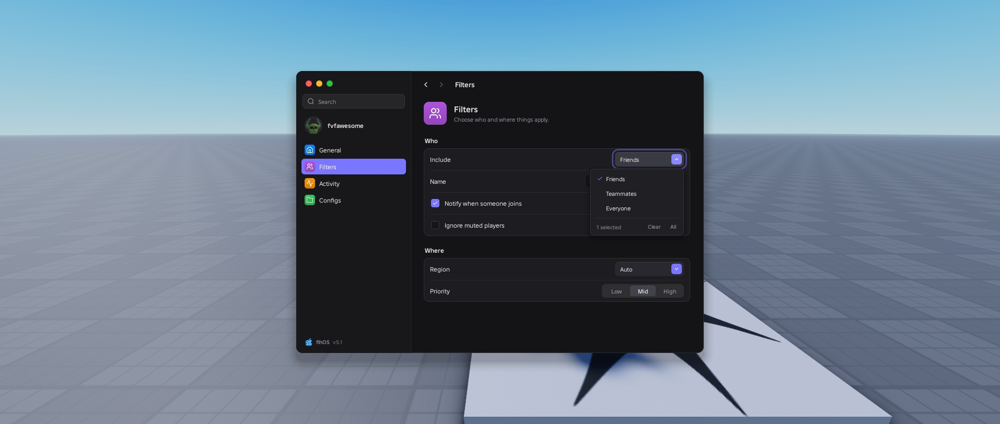
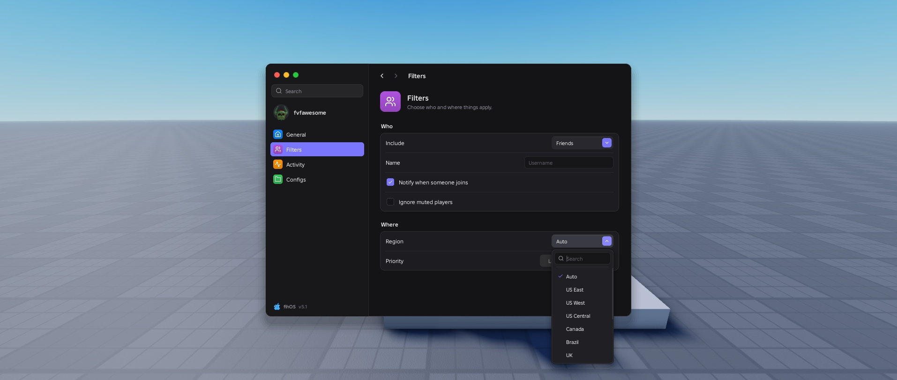

<div align="center">

# fihOS

**A premium dark interface library for Roblox, with a Dynamic Island launcher.**

Hover the island at the top of the screen for live stats. Click it, or press the menu key, and it morphs into the window.



</div>

---

## Features

- **Dynamic Island**: a pill at the top of the screen that shows FPS, ping, players, session time and what's running, and morphs into the window when opened.
- **macOS-style controls**: switches, checkboxes, sliders, steppers, push buttons, segmented controls, colour swatches, progress bars, text fields and shortcut recorders.
- **Dropdowns that behave**: single and multi-select, a search field for long lists, keyboard navigation (Up/Down, Return, Home/End, type to jump), and All/Clear in multi-select menus. Menus open downward and scroll instead of jumping above the button.
- **Six themes**: Onyx, Midnight, Graphite, Rosé, Halloween and Light, plus your own accent colour or a whole custom theme.
- **Search** across every tab, section and row from the sidebar.
- **Configs**: save, load, delete, and pick one to load at launch. Uses the executor's file API when it's there, and memory otherwise.
- **Notifications**: stacked banners in the bottom-right corner.
- **Scales to the screen**, works with touch, and cleans up after itself when destroyed or re-run.

---

## Install

### From GitHub (executors)

```lua
local fihOS = loadstring(game:HttpGet("https://raw.githubusercontent.com/YOUR_NAME/fihOS/main/fihOS.lua"))()
```

Replace `YOUR_NAME` with your GitHub username. To pin a version that won't change under your users, use a tag instead of `main`, for example `.../fihOS/v5.1.0/fihOS.lua`.

### In your own game (Roblox Studio)

`loadstring` and `HttpGet` aren't available to normal game scripts. Instead:

1. Put the contents of [`fihOS.lua`](fihOS.lua) in a **ModuleScript** named `fihOS` in `ReplicatedStorage`.
2. Require it from a **LocalScript**:

```lua
local fihOS = require(game:GetService("ReplicatedStorage"):WaitForChild("fihOS"))
```

---

## Quick start

```lua
local Window = fihOS:CreateWindow({
	Title = "fihOS",
	ToggleKey = Enum.KeyCode.RightControl,
})

local General = Window:AddTab({ Title = "General", Icon = "house", Description = "Core features and quick actions." })
local Behaviour = General:AddSection("Behaviour")

Behaviour:AddToggle({
	Title = "Enabled",
	Default = true,
	Flag = "Enabled",
	Callback = function(on)
		print("Enabled:", on)
	end,
})

Behaviour:AddDropdown({
	Title = "Mode",
	Options = { "Balanced", "Precise", "Relaxed" },
	Default = "Balanced",
	Flag = "Mode",
	Callback = function(choice)
		print("Mode:", choice)
	end,
})

Window:AddConfigTab()
Window:Notify({ Title = "Ready", Content = "Press RCtrl to open." })
```

There's a fuller demo in [`example.lua`](example.lua).

---

## Window

```lua
local Window = fihOS:CreateWindow(options)
```

| Option | Type | Default | What it does |
|---|---|---|---|
| `Title` | string | `"fihOS"` | Shown in the island, the sidebar footer and notifications |
| `Subtitle` | string | none | Muted text after the title in the sidebar footer |
| `Size` | Vector2 / UDim2 | `780 × 540` | Window size before scaling |
| `Theme` | string | `"Onyx"` | Any theme name (see [Themes](#themes)) |
| `Accent` | Color3 | the theme's own | Accent colour |
| `Colors` | table | none | Override any theme colour, e.g. `{ Window = Color3.fromRGB(16, 16, 18) }` |
| `ToggleKey` | KeyCode | `RightControl` | Opens and closes the window |
| `StartOpen` | boolean | `false` | Open the window straight away instead of showing the island |
| `ShowProfile` | boolean | `true` | Show the player's avatar and name in the sidebar |
| `Logo` | string | fihOS logo | Image id for the island, footer and notifications |
| `IslandSubtitle` | string | `Title` | Small caps line under the player name in the expanded island |
| `ConfigFolder` | string | `"fihOS"` | Folder in the executor workspace for configs |
| `Name` | string | `"fihOS"` | ScreenGui name. A window with the same name is replaced cleanly |
| `Parent` | Instance | `gethui()` or PlayerGui | Where the ScreenGui goes |

**Methods**

| Method | |
|---|---|
| `Window:AddTab(options)` | Adds a sidebar tab (see below) |
| `Window:Notify({ Title, Content, Duration, Icon })` | Shows a banner. `Duration` defaults to 5 seconds |
| `Window:Open()` / `Close()` / `Toggle()` | Show or hide the window |
| `Window:SelectTab(tab)` | Switch tabs from code |
| `Window:SetTheme(name)` | Change theme |
| `Window:SetAccent(color)` | Change the accent, or `nil` for the theme's own |
| `Window:SetToggleKey(key)` | KeyCode or its name, or `nil` for none |
| `Window:SetUserScale(scale)` | Interface size, `0.5` to `1.5` |
| `Window:SetZoomed(bool)` | Enlarge the window by 15% |
| `Window:SetTransparent(bool)` | Slightly see-through window |
| `Window:SetDim(bool)` | Dim the game behind the open window |
| `Window:SetIslandMode(mode)` | `"Hover"`, `"Expanded"`, `"Compact"` or `"Hidden"` |
| `Window:CenterWindow()` | Move the window back to the middle |
| `Window:AddConfigTab(options)` | Adds the Configs tab |
| `Window:SaveConfig(name)` / `LoadConfig(name)` | Save or load every flagged element. Both return whether they worked |
| `Window:ResetFlags()` | Put every flagged element back to its default |
| `Window:Destroy()` | Remove the interface and disconnect everything |

---

## Tabs and sections

```lua
local Tab = Window:AddTab({
	Title = "Combat",
	Icon = "swords",         -- see Icons below, or any rbxassetid://
	Description = "Shown in a header at the top of the page",
	Color = Color3.fromRGB(255, 69, 58), -- sidebar tile colour (optional)
	Columns = 2,             -- 1 (default) or 2 columns of sections
})

local Section = Tab:AddSection("Aim")
local Other = Tab:AddSection({ Title = "Visuals", Side = "Right", Footer = "Small print under the group." })
```

Elements can also be added straight to a tab: `Tab:AddToggle(...)` puts them in an untitled section.

---

## Elements

Every element takes a table of options. Elements with a `Flag` are saved in configs and are reachable through `fihOS.Flags[flag]`. Each returns an object with a `Value` and a `:Set(value, silent)` method. Pass `silent = true` to skip the callback.



### Toggle

```lua
Section:AddToggle({
	Title = "Enabled",
	Description = "Optional second line",
	Default = false,
	Keybind = Enum.KeyCode.F, -- optional: a shortcut field beside the switch
	Flag = "Enabled",
	Callback = function(on) end,
})
```

Toggles that are on show up in the island's **Running** list. Pass `Track = false` to leave one out.

### Checkbox

```lua
Section:AddCheckbox({ Title = "Ignore muted players", Default = false, Flag = "IgnoreMuted", Callback = function(on) end })
```

### Slider

```lua
Section:AddSlider({
	Title = "Intensity",
	Min = 0, Max = 100, Default = 65,
	Step = 1,          -- 0.1, 0.05 … sets the decimals shown
	Suffix = "%",
	Ticks = 5,         -- optional tick marks
	Stacked = false,   -- put the track under the title
	Flag = "Intensity",
	Callback = function(value) end,
})
```

Click the number to type a value.

### Stepper

```lua
Section:AddStepper({ Title = "Retries", Min = 0, Max = 10, Default = 3, Step = 1, Suffix = "", Flag = "Retries", Callback = function(value) end })
```

### Dropdown

```lua
local Region = Section:AddDropdown({
	Title = "Region",
	Options = { "Auto", "US East", "US West", "Europe", "Asia" },
	Default = "Auto",
	Placeholder = "Select",   -- shown when nothing is chosen
	Searchable = nil,         -- default: on for more than 8 options
	MaxRows = 8,
	Flag = "Region",
	Callback = function(choice) end,
})

local Include = Section:AddDropdown({
	Title = "Include",
	Options = { "Friends", "Teammates", "Everyone" },
	Default = { "Friends" },
	Multi = true,
	Flag = "Include",
	Callback = function(list) end, -- an array, in list order
})

Region:Set("Europe")
Region:Refresh({ "Auto", "Europe" })   -- new list; choices no longer in it are dropped
Include:GetSelected()                  -- { "Friends" }
```

### Button / Buttons

```lua
-- a row with a title on the left and a button on the right
Section:AddButton({ Title = "Run once", Description = "Fires once", ButtonText = "Run", Style = "Primary", Icon = "zap", Callback = function() end })

-- a full-width button (no ButtonText)
Section:AddButton({ Title = "Rejoin", Callback = function() end })

-- a grid of buttons, 2 per row by default
Section:AddButtons({
	{ Title = "Save", Callback = function() end },
	{ Title = "Delete", Style = "Danger", Callback = function() end },
}, 2)
```

`Style` is `"Default"`, `"Primary"` or `"Danger"`.

### Input

```lua
Section:AddInput({
	Title = "Name",
	Placeholder = "Username",
	Default = "",
	Numeric = false,
	Flag = "Name",
	Callback = function(text, enterPressed) end,
})
```

### Keybind

```lua
Section:AddKeybind({
	Title = "Quick action",
	Default = Enum.KeyCode.G,
	Flag = "QuickAction",
	Callback = function(key) end,         -- the key was pressed
	ChangedCallback = function(key) end,  -- the player picked a new key
})
```

Click the field and press a key. Backspace clears it, and Escape or a click elsewhere cancels.

### Segmented

```lua
Section:AddSegmented({ Title = "Priority", Options = { "Low", "Mid", "High" }, Default = "Mid", Flag = "Priority", Callback = function(choice) end })
```

### Swatches

```lua
Section:AddSwatches({
	Title = "Marker colour",
	Colors = { Color3.fromRGB(122, 118, 255), Color3.fromRGB(60, 200, 120) },
	Auto = false, -- true adds a "theme default" swatch whose value is nil
	Flag = "MarkerColor",
	Callback = function(color) end,
})
```

### Progress

```lua
local Goal = Section:AddProgress({ Title = "Daily goal", Default = 0.42 })
Goal:Set(0.8) -- 0 to 1
```

### Paragraph and label

```lua
local About = Section:AddParagraph({ Title = "About", Content = "Any amount of text. It wraps.", RichText = false })
About:Set({ Content = "New text" })

Section:AddLabel("A line of muted text")
```

---

## Themes

`Onyx` (default), `Midnight`, `Graphite`, `Rose` (shown as Rosé), `Halloween` and `Light`.

```lua
Window:SetTheme("Midnight")
Window:SetAccent(Color3.fromRGB(255, 95, 150))

-- your own: start from an existing theme and change what you like
fihOS:AddTheme("Ocean", {
	Window = Color3.fromRGB(12, 20, 28),
	Sidebar = Color3.fromRGB(16, 26, 36),
	Group = Color3.fromRGB(20, 32, 44),
	Accent = Color3.fromRGB(40, 190, 230),
}, "Midnight")
Window:SetTheme("Ocean")
```

Colour keys you can set: `Window`, `Sidebar`, `Group`, `Control`, `ControlHover`, `ControlPress`, `Field`, `Track`, `Menu`, `Segment`, `Line`, `Text`, `SubText`, `Muted`, `Knob`, `Shadow`, `Good`, `Warn`, `Bad`, `Accent`, and the `Island…` keys for the island.

---

## Configs

```lua
Window:AddConfigTab()
```

This adds a tab where players can create, save, load and delete configurations, and pick one to load at launch. Every element with a `Flag` is included. With an executor file API, configs go to `workspace/fihOS/configs/*.json`. Without one, they last for the session.

---

## Icons

Tabs and buttons take any of these names, or an `rbxassetid://` image:

`activity` `app-window` `bell` `box` `check` `chevron-down` `chevron-left` `chevron-right` `chevron-up` `chevrons-up-down` `circle` `circle-help` `circle-user` `clock` `code` `command` `copy` `cpu` `crosshair` `download` `ellipsis` `external-link` `eye` `eye-off` `file-text` `fish` `flame` `folder` `gamepad-2` `gauge` `gift` `globe` `heart` `house` `info` `keyboard` `layers` `link` `list` `lock` `log-out` `map` `maximize-2` `minimize-2` `minus` `monitor` `moon` `mouse-pointer-2` `package` `palette` `pencil` `plus` `power` `refresh-cw` `rotate-ccw` `save` `search` `settings` `shield` `sliders-horizontal` `snowflake` `sparkles` `star` `sun` `swords` `target` `terminal` `timer` `trash-2` `trending-up` `upload` `user` `users` `webhook` `wifi` `x` `zap`

---

## Credits

- Icons: [Lucide](https://lucide.dev) (ISC licence).
